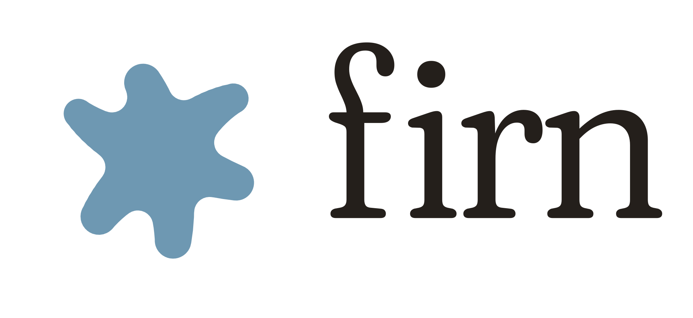

<p align="center">
  
</p>

<p align="center"><strong>A calm browser for the Mac.</strong><br>
Privacy, simplicity, calm, and beauty.</p>

---

Firn is a quiet, minimalist web browser built natively for the Mac in Swift, SwiftUI, and WebKit. It takes the best ideas from browsers like Arc, Dia, and Zen and brings them to everyone, not just power users, without the clutter.

The name comes from firn: the settled, compacted snow high on alpine glaciers. Quiet, clean, and still.

## What makes it different

- **Every space is its own browser.** Work and Personal each have their own tabs, sign-ins, cookies, and history. Signing into Gmail in one doesn't sign you in to the other. You can choose to share sign-ins between two spaces when you create one.
- **Basecamp.** A grid of your everyday sites at the top of each space, different in every space.
- **Groups.** Keep tabs together in soft frosted cards. Drag one tab onto another to make a group.
- **Tidied away.** Tabs you haven't looked at for a while drift quietly into a small button, so the sidebar stays clear. Nothing disappears without you seeing where it went.
- **Lookout.** Preview a link in a floating panel before deciding to keep it.
- **Split view.** Two pages side by side. Drag a tab onto the page to make one.
- **Command bar.** Press ⌘T to type an address, search, jump to a tab, or run an action by name.
- **Ad and tracker blocking.** Built in and on by default, and you can turn it off for a single site.

## Privacy

Your data stays on your Mac. Firn has no accounts, no tracking, and no telemetry. Each separate space keeps its own website data, and nothing from one space shows up in another.

## Requirements

macOS 14 Sonoma or later. Firn looks its best on macOS 26, with Liquid Glass.

## Building from source

You'll need Xcode.

```bash
xcodebuild -scheme Firn -destination 'platform=macOS' build
```

Most of Firn's logic lives in the `FirnCore` Swift package and can be tested from the command line:

```bash
cd FirnCore && swift test --scratch-path ~/Library/Caches/FirnCore-build
```

## License

Firn's code is open source under the [Mozilla Public License 2.0](LICENSE).

The Firn name, logo, and app icons (`brand/` and the app icon) are **not** covered by that license and may not be used without permission.

Firn includes the Fraunces typeface, under the [SIL Open Font License](Firn/Fonts/Fraunces-OFL.txt).
